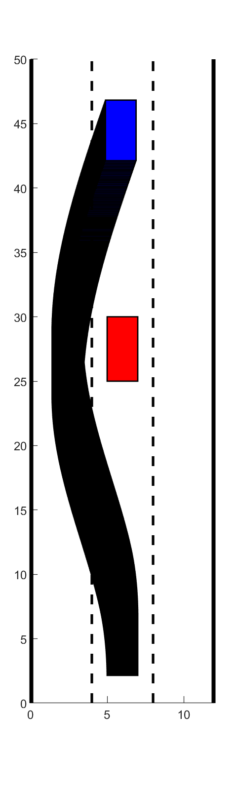
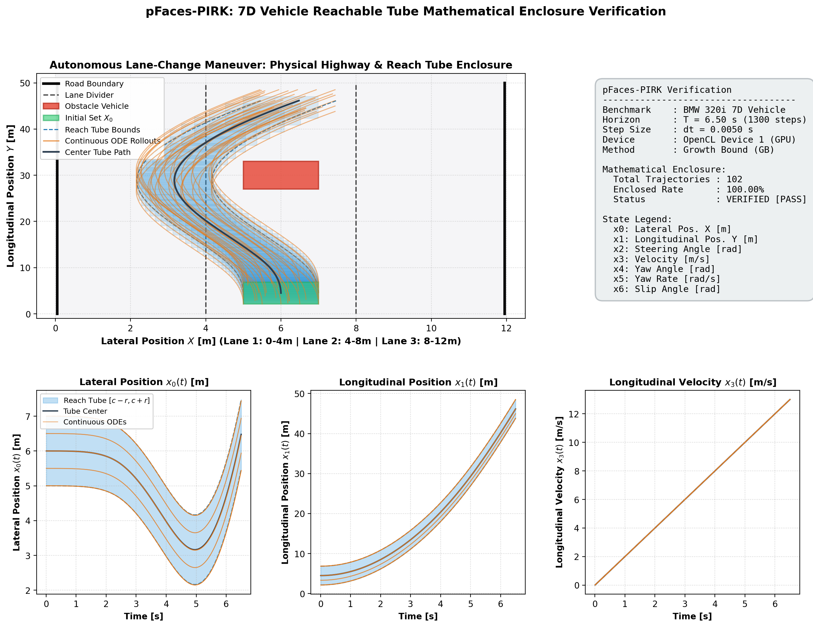
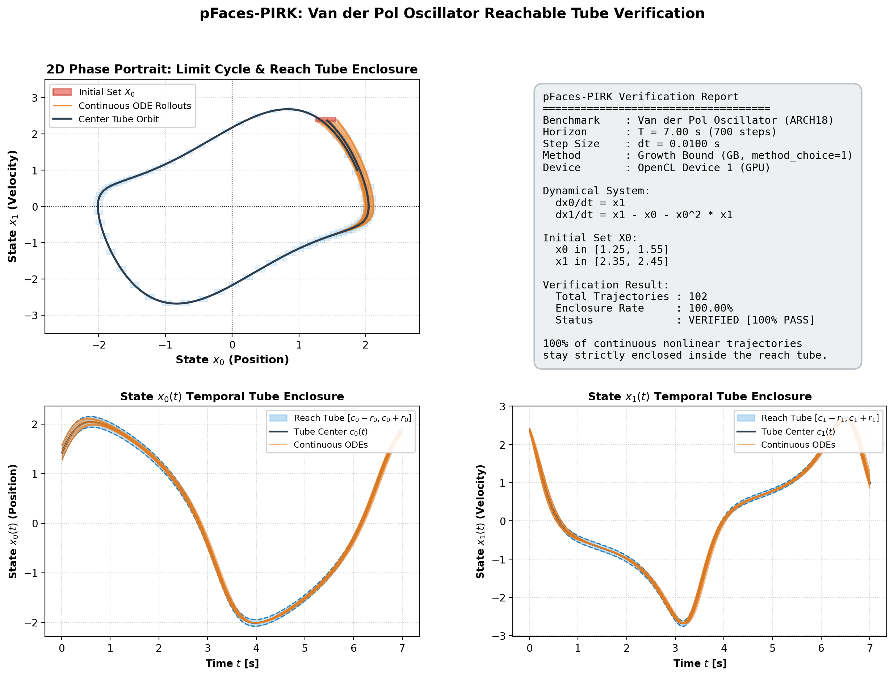
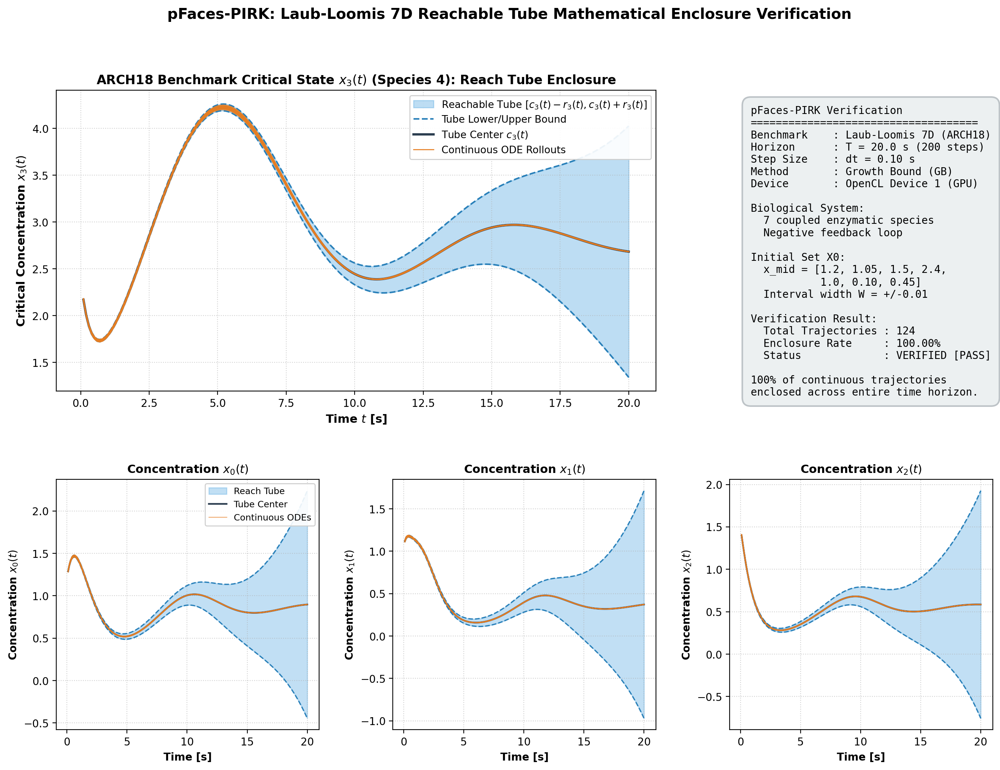
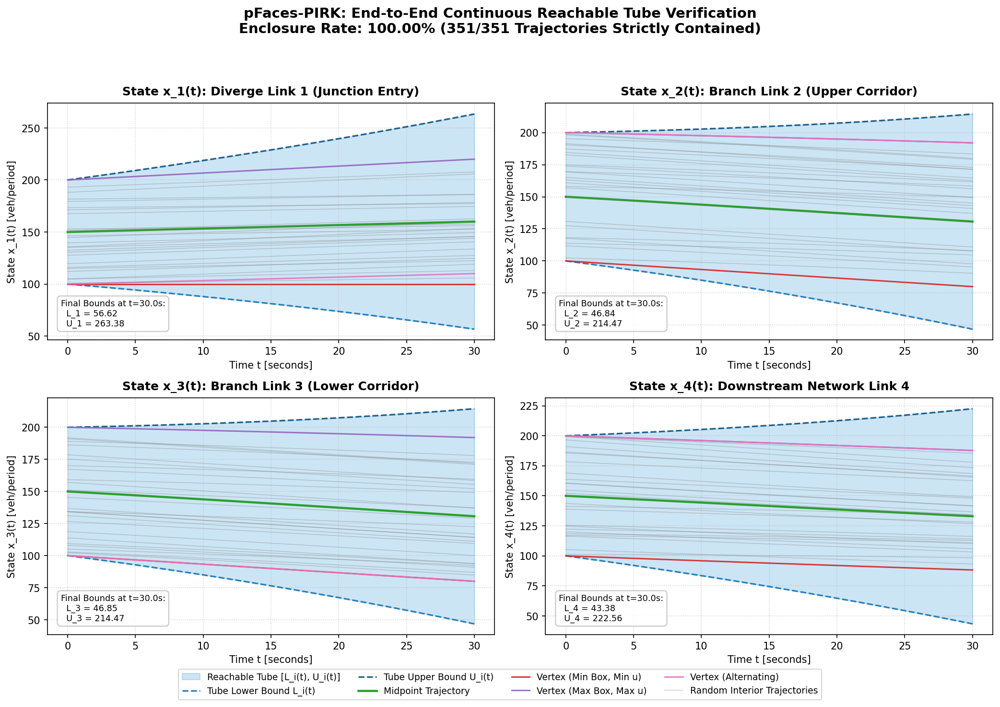

# **PIRK**: Parallel Computation of Reachable Sets for General Nonlinear Systems  

[](https://github.com/mkhaled87/pFaces-PIRK/actions/workflows/ci.yml)
[](https://github.com/parallall/pFaces)
[](LICENSE)

> **Note:** This tool works on top of the demo version of pFaces. If you face any LICENSE issues (e.g., expired license), install the latest version of pFaces or use the latest license file from the latest demo version of pFaces. Latest demo version of pFaces can always be found [here](https://github.com/parallall/pFaces/releases).

PIRK is a tool to efficiently compute reachable sets for general nonlinear systems of *extremely high dimensions*.
It introduces three parallel algorithms for computing interval approximations of forward reachable sets, based on: component-wise contraction properties, mixed monotonicity, and Monte Carlo-based approaches.

Implemented to utilize the acceleration ecosystem [pFaces](https://github.com/parallall/pFaces), PIRK targets HPC platforms for computing the reachable sets. It has been tested on several systems, with state dimensions ranging from ten up to 4 billion.
The scalability of PIRK's parallel implementations is found to be highly favorable.

PIRK can be used to:
- Compute the reachable sets (or pipes) for high-dimensional nonlinear systems. For instance, in the provided examples [n-links traffic network](/examples/ex_n_links/) and [Quadrotor swarm](/examples/ex_quadrotor_swarm/), PIRK can compute the reachable sets for systems with up to 4 billion state variables.

- Efficiently verify the behavior of systems. Given a fixed time-window and input sequence, PIRK calculates, efficiently, the reach pipe of the of the system in hand. This can be verify that the behavior of the system will not violate the design specification. For now, this requires extra code from the user side to verify the computed reach pipe. In the provided [BMW 320i example](/examples/ex_vehicle7d/), PIRK computes in milliseconds the reach pipe of the vehicle in planned lane-change maneuver, which helps verify that that the autonomously-driven car will not crash into the car in front of it. The result of running this example is provided in the *Getting Started* section below in this guide.

# **Installation using Docker**
Here, we assume you will be using Linux or MacOS machine. Commands will be slightly different on Windows if you use Windows PowerShell.

First, make sure to configure Docker to use all of the resources available (e.g., all CPU cores). Otherwise, PIRK will run slower than expected. Also, in case you are using a GPU, make sure to pass-through the GPU in Docker. See this [guide](https://docs.docker.com/config/containers/resource_constraints/).

Download the Dockerfile:
``` bash
$ mkdir pirk
$ cd pirk
$ wget https://raw.githubusercontent.com/mkhaled87/pFaces-PIRK/master/Dockerfile
```    

Build the Docker image:
``` bash
$ docker build -t pirk/latest .
```    

Run/enter the image's interactive shell
``` bash
$ docker run -it pirk/latest
```    

Now you can use PIRK. It is located in the director **pFaces-PIRK** in the Docker container and you can navigate to it as follows:
``` bash
$ cd pFaces-PIRK
```

In the Docker image, we installed Oclgrind to simulate an OpenCL platform/device that utilizes all the CPU cores using threads. Unless you will be passing-through your device (e.g., a GPU), you MUST precede any pFaces command with oclgrind. For example, to check available devices in the prespective of Oclgrind, run:
``` bash
$ oclgrind pfaces -CG -l
```


# **Installation using Source code**

## **Prerequisites**

You first need to have have [pFaces](https://github.com/parallall/pFaces) installed on the target machine. Once installed, test its installation and make sure it recognizes the parallel hardware in your machine by running the following command:

```
pfaces -CG -l
```

where the command *pfaces* here calls pFaces launcher as installed in your machine. This should list all available HW configurations (HWCs) attached to your machine. If you see one or more devices, this means you are ready to work with PIRK. In case a device you know is not listed, you may need to install its device-driver or any OpenCL runtime environment that is provided by the vendor.

### **Building PIRK**

PIRK uses CMake for cross-platform building.
We support Windows, Linux and MacOS.
PIRK was tested on Windows 10x64, Linux Ubuntu 18.04 and MacOS 10.
In Windows, you must use the developer command prompt of Visual Studio so that CMake is integrated.
Start by cloning this repo to some place in your machine (commands prompt is a little different in Windows):

``` bash
$ git clone --depth=1 https://github.com/mkhaled87/pFaces-PIRK
```

Now, run the build script that automates the CMake-based build.
For MacOS/Linux:

``` bash
$ cd pFaces-PIRK
$ ./build.sh
```

For MacOS/Linux:

``` bash
> cd pFaces-PIRK
> .\build.bat
```

A successful build will generate the kernel driver `pirk.driver` in the `kernel-pack` folder.


# **Getting Started**

Now, you have PIRK installed and ready to be used. You might now run a given example or build your own.

## **File structure of PIRK**

- [examples](/examples): the folder contains pre-designed examples.
- [interface](/interface): the folder contains the Matlab interface to access the files generated by PIRK.
- [kernel](/kernel): the folder C++ source codes of PIRK.
- [kernel-pack](/kernel-pack): the folder contains the OpenCL codes of the PIRK and will hold the binaries of the loadable kernel of PIRK.
- [tools](/tools): some independent PIRK-related tools the that can be used to test the dynamics of the systems.

## **Running an example**



Navigate to any of the examples in the directory [/examples](/examples). Within each example, one or more *.cfg* files are provided. 
Such config files tell PIRK about the system being considered and the requirements PIRK should consider when computing the reach sets.

Say you navigated to the example in [/examples/ex_vehicle7d](/examples/ex_vehicle7d). This examples is provided to compute the reach pipe of an autonomous vehicle making a lane-change manuever in the highway.
To run this example, we launch PIRK with the config file [vehicle.cfg](/examples/ex_vehicle7d/vehicle.cfg). Run the following command from any terminal running on the example's folder:

```
pfaces -CG -d 1 -k pirk.cpu@../../kernel-pack -cfg ./vehicle.cfg -p
```

where **pfaces** calls pFaces launcher, "-CG -d 1" asks pFaces to run on the first device of all available devices, 
"-k pirk@../../kernel-pack" tells pFaces about PIRK and where it is located, 
"-cfg vehicle.cfg" asks pFaces to hand the configuration file *vehicle.cfg* to PIRK, and 
"-p" asks pFaces to collect profiling information. 
Make sure to replace each / with \ in case you are using Windows command line.

pFaces will take some time (depending on your HW) to solve the reachability problem. The output will be stored in a file *vehicle.raw* which contains the reach pipe of this system. 

We developed a Matlab-interface so that Matlab users can load and use the files generated from PIRK. If you have Matlab installed, open it and navigate to this example's folder. Running the Matlab script file *simulate.m* will use the Matlab-interface to load and plot the reach sets stored in the output file. The reach pipe should loop like the image on the right side.


## **Building your own example**

We recommend copying and modifying one of the provided examples to avoid syntactical mistakes. An example in PIRK is mainly some text files:

- A configuration file (.cfg) describing the example.
- A file (dynamics.cl) describing the dynamical system being considered.
- A file (bounds.cl) setting the initial hyper-interval for states and inputs.
- Based on the method chosen, one or more additional files may be required.


### **The configuration files**
A configuration file (.cfg) corresponds to a case describing a reachability analysis problem. Config files are text files with scopes and contents on the form: 'scope_name { contents }', where the contents is a list of semicolon-delimited key="value" pairs. The following is an example of a scope with contents:

    country = "Egypt";
    city {
	    name = "Cairo";
        population = "9.5 million";
    }

Some keys does not require parent scopes. All values need to be enclosed with double quotes. Now, take a quick look to this [config](/examples/ex_toy_safety/toy2d.cfg) file to get to know about the scopes/contents used in PIRK's config files. The following are the all the keys that can be used in PIRK. 

- **project_name**: a key to describe the name of the project and will be used as a name for the output file.

- **data**: describes the used data model and should be currently set to "raw". Later, we plan to support more data types with compressions to save memory.

- **method_choice**: an integer [1-4] that describes the method used to compute the reach sets. The value can be any of:

    1: (GB) Growth/Contraction Matrix,

    2: (CTMM) Continious-time mixed monotonicity,

    3: (MC) Monte-carlo based simulation, or

    4: (MC_hd) Monte-carlo based simulation (High Definition).


- **mem_efficient**: a true/false value to enable/disable the memory efficient versions of the implemented algorithms. It is currently supported for the GB method. It should be set to *"false"* for other methods.

- **record_pipe**: a true/false value to enable/disable the recording of the reach pipe. When set, an additional output file will be saved for the reach pipe.

- **initial_time**: initial value for the time.

- **final_time**: final value for the time.

- **step_size**: time quantization step.

- **states.dim**: The dimension of the state set (number of state variables).

- **inputs.dim**: The dimension of the input set (number of input variables).


### **System Dynamics and State/Input Bounds**

The dynamics of the system is described in the (dynamics.cl) file. The file should contain C-language code and a callback function with the following signature:

    float dynamics_element_global(__global float* x, __global float* u, float t, unsigned int i);

where *x* and *u* are the supplied state and input vectors at time *t*. The function should return the RHS value of the system's differential equation with respect to the state variable number *i*. *i* will take values from *0* to *N-1* where *N* is the number of state variables.

The computation of the reach set starts with a pre-defined hyper-rectangle (a.k.a. hyper-interval) over the states and inputs sets. This should be supplied by the user in the file (bounds.cl) which should contain four callback functions with the following signatures:

    float initial_state_lower_bound(unsigned int i);
    float initial_state_upper_bound(unsigned int i);
    float input_lower_bound(unsigned int i);
    float input_upper_bound(unsigned int i);

where each function receives *i*, asking for the *i*th component of the lower (resp. upper) bound value of the initial state (resp. input) set. 

There is no need to rebuild PIRK anytime you modify those files or create new examples. PIRK simply loads and injects the files into the OpenCL kernel that is sent to pFaces. pFaces then takes care of the online compilation of all OpenCL codes. 

### **Method-specific Requirements**

### *For the method (1: GB)*

Apart from setting *method_choice* to *"1"*, users need to specify the growth/contraction matrix. A separate file (growth_bound_matrix.cl) must be provided and it should contain a callback function with the following signature:

    float growth_bound_matrix(int i, int j);

which provides the value in the growth/contraction matrix for the *i*th row and *j*th column.

### *For the method (2: CTMM)*

Apart from setting *method_choice* to *"2"*, users need to specify the bounds of the Jacobian. A separate file (jacobian_bounds.cl) must be provided and it should contain a callback functions with the following signatures:

    float state_jacobian_lower_bound(unsigned int i, unsigned int j);
    float state_jacobian_upper_bound(unsigned int i, unsigned int j);


Both functions provide the lower (resp. upper) value in the Jacobian matrix for the *i*th row and *j*th column.

### *For the methods (3: MC, 4:MC_hd)*

Apart from setting *method_choice* to *"3"* (resp. *"4"*), users need to specify the number of simulations to be done. Each simulation will pick, randomly, an initial state vector and input vector, and simulate the dynamics based on them. The reach set will be the final set enclosing the reach states from all simulations.

To specify the number of simulation (e.g., 1000 simulations), the following configuration must be set in the config file:

    nsamples = "1000";

The required number of samples can be computed using the formula: 

    nsamples = ceil((2*n/epsilon)*log(2*n/delta)), 

where n is the state dimension and epsilon=delta=0.05 are parameters to control the probabilistic guarantee. 


# **Verified Continuous Reachability Benchmarks**

PIRK includes an end-to-end continuous reachability verification test suite. For each benchmark, PIRK computes interval reach sets or continuous reach tubes (via Growth-Bound, Continuous-Time Mixed Monotonicity, or Monte-Carlo techniques), while standalone Python verification scripts solve continuous nonlinear ODE initial value problems (using `scipy.integrate.solve_ivp` with high-accuracy RK45) across boundary and interior sampled initial states. Each script mathematically verifies and asserts **100% enclosure** within the computed reach pipe/tube over the entire time horizon and generates publication-quality visualization figures.

To run the complete automated verification test suite locally:
```bash
sh test.sh
```

---

### **1. 7D Vehicle Lane-Change Maneuver (`ex_vehicle7d`)**
- **Location**: [`examples/ex_vehicle7d`](examples/ex_vehicle7d)
- **Dynamical Model & Problem**:
  A 7-state nonlinear single-track vehicle model based on BMW 320i parameters executing a high-speed evasive lane-change maneuver on a highway over time horizon $t \in [0, 4.0]\text{ s}$ with step size $dt = 0.04\text{ s}$ (100 macro steps, 5 sub-steps/step, RK4).
  The state vector $\mathbf{x} = [s_x, s_y, \delta, v, \psi, \dot{\psi}, \beta]^T$ captures:
  - $s_x, s_y$: Longitudinal and lateral position in global Cartesian coordinates.
  - $\delta$: Front-wheel steering angle.
  - $v$: Longitudinal vehicle velocity.
  - $\psi, \dot{\psi}$: Inertial heading angle and yaw rate.
  - $\beta$: Vehicle side-slip angle.

  The system dynamics incorporate nonlinear tire slip kinematics:
  $$\dot{s}_x = v \cos(\psi) - v \tan(\beta) \sin(\psi), \quad \dot{s}_y = v \sin(\psi) + v \tan(\beta) \cos(\psi)$$
  $$\dot{\delta} = u_1, \quad \dot{v} = u_2, \quad \dot{\psi} = \dot{\psi}, \quad \ddot{\psi} = \frac{a F_{y,f} - b F_{y,r}}{I_z}, \quad \dot{\beta} = \frac{F_{y,f} + F_{y,r}}{m v} - \dot{\psi}$$
  PIRK computes the growth-bound bounding tube around nominal trajectory $c(t)$ with interval radius $r(t)$. Initial states start from nominal conditions with interval radii bounding the physical vehicle footprint ($r_0 = 1.0\text{ m}$ half-width, $r_1 = 2.35\text{ m}$ half-length). Continuous trajectory rollouts under time-varying steering inputs verify 100% enclosure within the computed reach tube.

- **Commands to Compute and Verify**:
  ```bash
  cd examples/ex_vehicle7d
  pfaces -CG -d 1 -k pirk.cpu@../../kernel-pack -cfg ./vehicle.cfg -p -co "record_pipe=true"
  python3 verify_vehicle7d.py
  ```

- **Visual Verification Plot**:
  

---

### **2. 2D Van der Pol Nonlinear Limit Cycle (`arch18_benchmark/vdp_oscillator`)**
- **Location**: [`examples/arch18_benchmark/vdp_oscillator`](examples/arch18_benchmark/vdp_oscillator)
- **Dynamical Model & Problem**:
  The classic nonlinear Van der Pol oscillator from the ARCH-COMP 2018 benchmark suite, exhibiting non-conservative limit cycle dynamics over $t \in [0, 7.0]\text{ s}$ ($dt = 0.01\text{ s}$, 700 steps):
  $$\dot{x}_1 = x_2, \quad \dot{x}_2 = \mu (1 - x_1^2) x_2 - x_1, \quad \mu = 1.0$$
  The initial set is an uncertain box $X_0 = [1.25, 1.55] \times [2.25, 2.45]$. PIRK evaluates the logarithmic matrix norm of the state Jacobian $\mu_\infty(J)$ to compute conservative bounding intervals that tightly envelope nonlinear trajectory expansion and convergence toward the periodic orbit. Continuous trajectories simulated with `scipy.integrate.solve_ivp` achieve 100% mathematical enclosure with $< 10^{-4}$ tolerance.

- **Commands to Compute and Verify**:
  ```bash
  cd examples/arch18_benchmark/vdp_oscillator
  pfaces -CG -d 1 -k pirk.cpu@../../../kernel-pack -cfg ./vdp_oscillator.cfg -p -co "record_pipe=true"
  python3 verify_vdp.py
  ```

- **Visual Verification Plot**:
  

---

### **3. 7D Laub-Loomis Enzymatic Reaction Network (`arch18_benchmark/laub_loomis`)**
- **Location**: [`examples/arch18_benchmark/laub_loomis`](examples/arch18_benchmark/laub_loomis)
- **Dynamical Model & Problem**:
  The 7-state ARCH-COMP enzymatic reaction network benchmark modeling spontaneous activation and oscillations of adenylyl cyclase in *Dictyostelium discoideum* over time horizon $t \in [0, 20.0]\text{ s}$ ($dt = 0.1\text{ s}$, 200 steps):
  $$\dot{x}_1 = 1.4 x_3 - x_1$$
  $$\dot{x}_2 = 2.5 x_2 - 1.5 x_2 x_3$$
  $$\dot{x}_3 = 0.6 x_1 - 2.0 x_2 x_3 + 0.1$$
  $$\dot{x}_4 = 2.0 - 1.5 x_4 x_5$$
  $$\dot{x}_5 = 5.0 x_1 - 4.0 x_5$$
  $$\dot{x}_6 = 1.5 x_2 - x_6$$
  $$\dot{x}_7 = x_4 - x_7$$
  Initial conditions start from an interval box $X_0 = \bar{x}_0 \pm 0.010$ around nominal operating concentrations. PIRK tightly bounds the sharp transient peak in species $x_4$ before settling toward steady state, maintaining 100% verified enclosure across all 7 chemical concentrations.

- **Commands to Compute and Verify**:
  ```bash
  cd examples/arch18_benchmark/laub_loomis
  pfaces -CG -d 1 -k pirk.cpu@../../../kernel-pack -cfg ./laub_loomis.cfg -p -co "record_pipe=true"
  python3 verify_laub_loomis.py
  ```

- **Visual Verification Plot**:
  

---

### **4. 10-Link Traffic Flow Network (`ex_n_links`)**
- **Location**: [`examples/ex_n_links`](examples/ex_n_links)
- **Dynamical Model & Problem**:
  A 10-link nonlinear traffic network modeling queue length dynamics and congestion spillback governed by downstream link capacities, bottlenecks, and switching demand inputs. PIRK computes interval reach sets using multiple methods:
  - Growth-Bound (standard and memory-efficient)
  - Continuous-Time Mixed Monotonicity (CTMM)
  - Monte Carlo simulation (standard and high-definition)

  The verification script evaluates bounding box containment across all 10 links over time, comparing the over-approximative Growth-Bound interval tube with empirical Monte-Carlo trajectories.

- **Commands to Compute and Verify**:
  ```bash
  cd examples/ex_n_links
  pfaces -CG -d 1 -k pirk.cpu@../../kernel-pack -cfg ./ex_n_link.cfg -p -co "record_pipe=true"
  pfaces -CG -d 1 -k pirk.cpu@../../kernel-pack -cfg ./ex_n_link.cfg -p -co "mem_efficient=true"
  pfaces -CG -d 1 -k pirk.cpu@../../kernel-pack -cfg ./ex_n_link.cfg -p -co "method_choice=2"
  pfaces -CG -d 1 -k pirk.cpu@../../kernel-pack -cfg ./ex_n_link.cfg -p -co "method_choice=3"
  pfaces -CG -d 1 -k pirk.cpu@../../kernel-pack -cfg ./ex_n_link.cfg -p -co "method_choice=4"
  python3 verify_reachability.py
  ```

- **Visual Verification Plot**:
  

---

## **Authors**

- [**Mahmoud Khaled**](http://www.mahmoud-khaled.com)*.
- [**Alex Devonport**](https://people.eecs.berkeley.edu/~arcak/people.html)*.
- [**Mjid Zamani**](https://www.colorado.edu/cs/majid-zamani).
- [**Murat Arcak**](https://www2.eecs.berkeley.edu/Faculty/Homepages/arcak.html).

*: Both authors have the same contribution.

## **Publications**

- A. Devonport$, M. Khaled, M. Arcak, M. Zamani. PIRK: Scalable Interval Reachability Analysis for High-Dimensional Nonlinear Systems. 32nd Conference on Computer Aided Verification (CAV), July 2020.

Please cite the tool paper as follows:

    @inproceedings{PIRK,
        title = {PIRK: Scalable Interval Reachability Analysis for High-Dimensional Nonlinear Systems},
        author = {Devonport, Alex and Khaled, Mahmoud and Arcak, Murat and Zamani, Majid},
        booktitle = {Proc. 32nd International Conference on Computer Aided Verification (CAV)},
        publisher = {Springer},
        series = {LNCS},
        year = {2020}
    }


## **License**

See the [LICENSE](LICENSE) file for details
